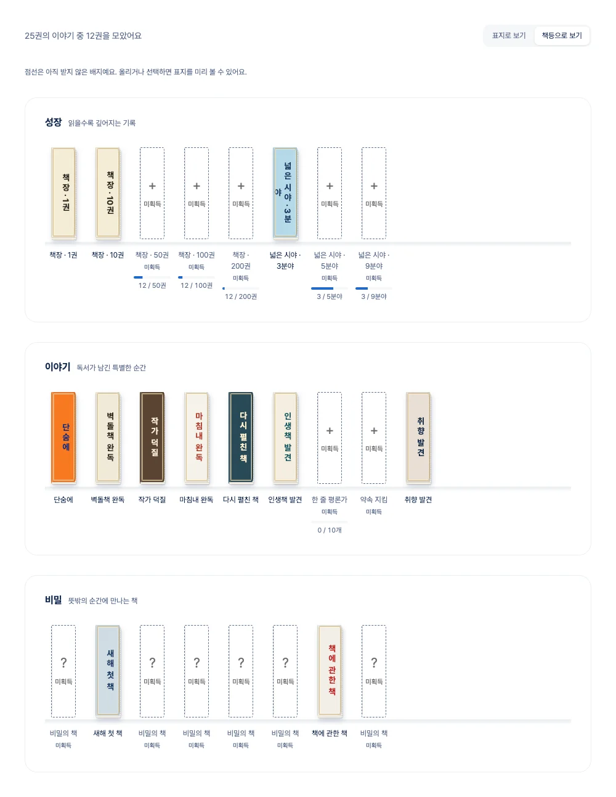

# 배지 책장 · 단행본 표지 UI

금테 메달 대신 같은 판형의 작은 책을 모은다. 표지는 아이콘이 아니라 제목·색·서체·인쇄 질감으로 구분한다. 배지 19종과 성장 8단계를 합쳐 25가지 표지를 제공한다.

## 화면

- 서재: 최근 받은 표지를 모바일 3권, 데스크톱 5권까지 선반에 놓는다. 전체 보기와 각 배지 상세로 연결된다.
- 배지 목록: 성장·이야기·비밀 선반을 구분하고 표지/책등 보기를 전환한다. 진행 수치는 권·분야·개 단위로 표시한다.
- 상세: 선택한 표지를 펼치면 획득 날짜와 해당 책의 공개 상세 링크가 나온다. 닫았다 다시 열면 표지도 닫힌 상태로 돌아온다.
- 미획득: 일반 배지는 회색 표지와 제목을 보여준다. 비밀 배지는 공통 제본 표지만 보여주고 이름·조건·획득 근거를 숨긴다. 방문자는 받은 배지만 본다.
- 테마: 표지 인쇄 색은 그대로 보존하고 선반·이름·모달 표면은 기존 라이트/다크 토큰을 사용한다.
- 움직임: 목록은 정면을 유지하며 호버에서 위로 조금 올라온다. 상세에서만 표지가 회전하며, 모션 감축 설정에서는 애니메이션을 끈다.

## 검토용 화면

다음 이미지는 Storybook 목 데이터로 촬영했다. 실제 사용자 데이터가 아니다.

| 모바일 | 다크 모드 |
| --- | --- |
|  |  |

## 유지보수

표지의 제목 줄바꿈은 `badgePresentation.ts`, 제본·인쇄 그래픽은 `BadgeMedal.module.css`, 목록과 선반은 `BadgeShelf.module.css`에서 관리한다. 획득 계산은 기존 `computeBadges`를 유지한다. 승인된 표시 이름만 정리했으며 ID·조건·데이터베이스는 변경하지 않았다.

표지 제목은 이미지에 구워 넣지 않고 실제 텍스트로 렌더링한다. 따라서 성장 숫자가 바뀌어도 이미지 재생성이나 추가 요청이 없다. 표지용 Noto 고딕·명조는 제목 글자만 포함한 WOFF2를 자체 호스팅하며 합계 약 25KB다. 라이선스와 글꼴 정보는 `public/badges/editorial/`에 함께 둔다. 표지 이름을 추가할 때는 글꼴 서브셋에 해당 글자가 있는지도 확인한다.

검증: 앱 전체 단위 테스트 1,027개, Storybook 브라우저·접근성 테스트 107개, 타입 검사, 린트. 브라우저에서 360px 화면·다크·책등·상세 열기와 개발 DB 공개 서재/배지 경로를 확인했다. 로컬 개발 DB에는 운영 계정 `stronger_khj`가 없어 개발 공개 계정으로 라우트를 확인했다.
