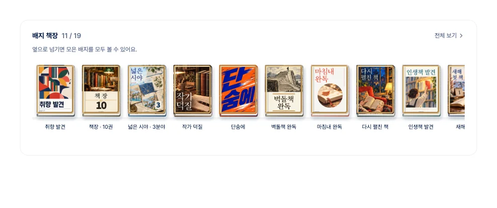
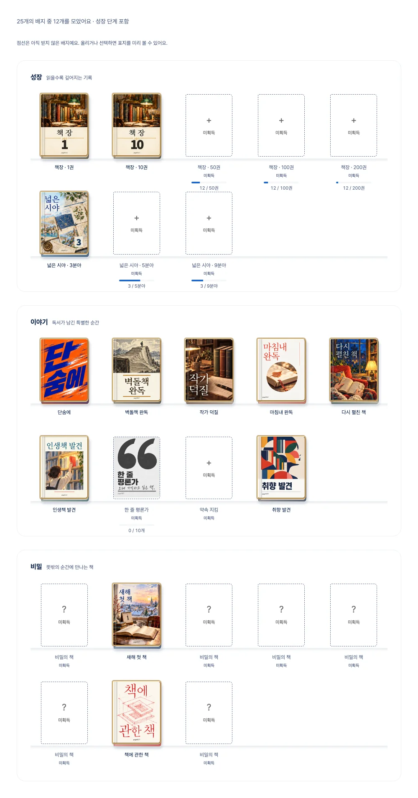
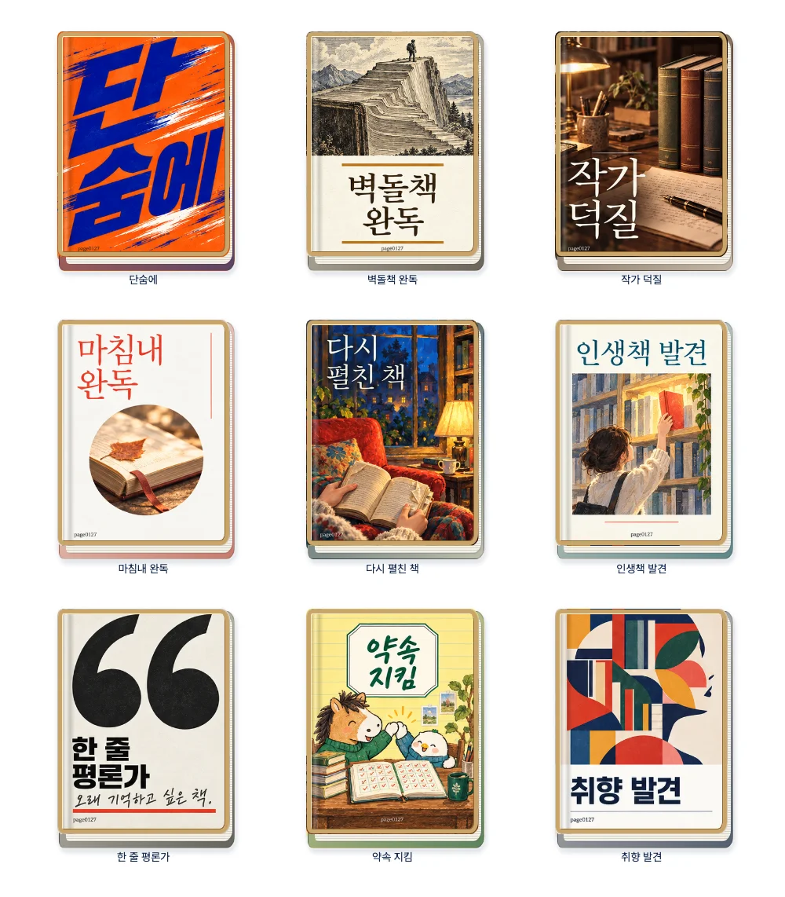
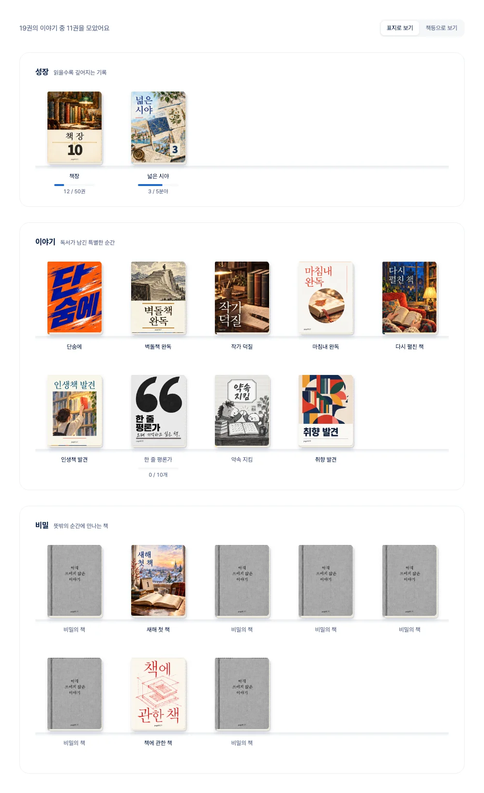
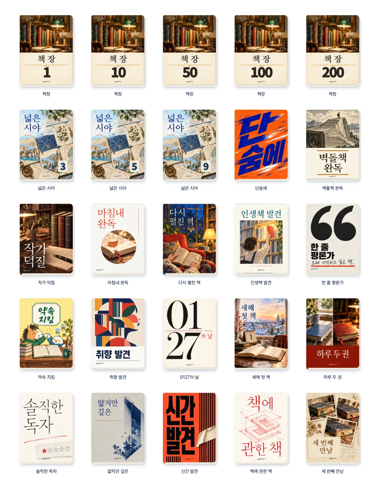
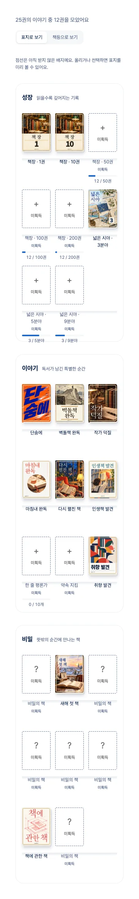
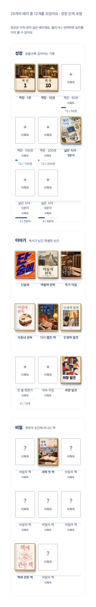
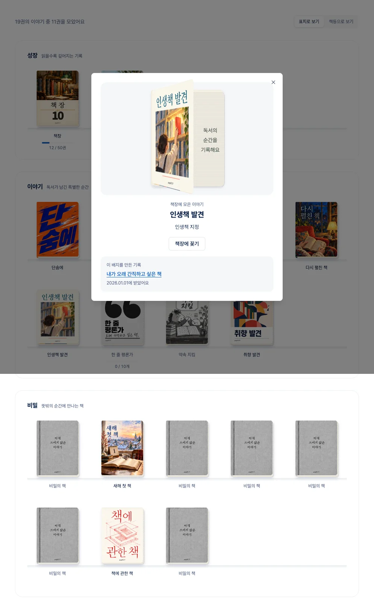
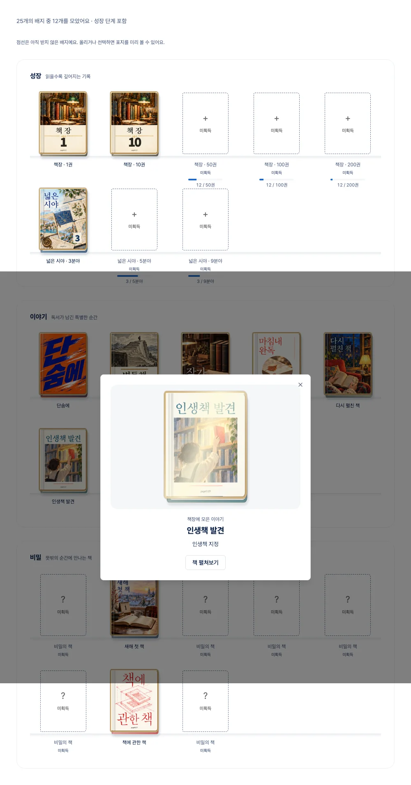

# 배지 책장 · 실제 표지 아트

같은 책 형태 안에 서로 다른 출판 디자인을 담는다. 큰 글자·판화·사진·회화·삽화·여백·기하학을 섞고, 표지의 소재는 각 배지의 제목과 획득 조건에서 고른다.

## 2026-10-25 확장

배지는 성장 4종·분야 9종·이야기 10종·히든 8종, 총 **31종**이다. 단계 수를 전체 종류에 중복 합산하지 않는다.

- **쌓이는 이야기**(이전 책장): 1·5·10·25·50·100·200·300·500·1,000권
- **넓은 시야**: 2·3·5·7·9분야
- **고전 / 시간을 건너온 책**: 1·5·10·25·50권. 도서 공급자의 고전 분류만 기준으로 한다.
- **서재 단골**: 누적 7·30·100일 방문. KST 하루 1행이며 연속 방문 조건은 없다. 원본 방문 이력은 비공개, 타인에게는 달성 단계만 공개한다.
- **분야별 9종**: 각 분야의 서로 다른 책 3·10·30·50·100권
- **취향의 교집합**: 다른 독자와 첫 독서 케미 분석 완료. 참여한 두 독자가 함께 받는다.

성장 배지는 최고 달성 단계 하나와 이전 두 단계 표지를 포개어 보여 준다. 단계에 따라 제본 색이 달라지고, 숫자는 표지 오른쪽 아래에 계열별 색상의 네모 메모지로 표시한다. 메모지는 살짝 기울어진 종이와 얇은 그림자로 포스트잇 느낌을 낸다. 상세에서 단계별 획득 날짜를 확인할 수 있다. 히든은 이름과 조건을 가리되 짧은 힌트를 표시한다.

표지는 `story-art-v3.png`, `companion-art-v7.png`, `expansion-art-v5.png`를 사용한다. 회색 공통 비밀 표지는 기존 `companion-art-v2.png`를 그대로 유지한다. 제목·여백·서체는 아트 자체에서 조정하며 **CSS로 표지를 축소하거나 안쪽 여백을 추가하지 않는다**. 새 표지의 최종 편집 프롬프트는 [expansion-art-prompts.json](expansion-art-prompts.json)에 보관한다.

아래 표와 검수 이미지는 확장 전 디자인의 기록이다.

## 기존 표지와 획득 조건

| 배지         | 조건                         | 표지에 담은 의미와 스타일                             |
| ------------ | ---------------------------- | ----------------------------------------------------- |
| 책장         | 완독 1·10·50·100·200권       | 책이 쌓인 고전 서재 회화와 단계 숫자                  |
| 넓은 시야    | 3·5·9개 분야 완독            | 천문·식물·도시 지도가 펼쳐지는 아틀라스 콜라주        |
| 단숨에       | 시작한 날 완독               | 속도감 있는 타이포그래피와 인쇄 흔적                  |
| 벽돌책 완독  | 500쪽 초과 완독              | 책장이 산처럼 쌓인 고전 판화와 정상의 독자            |
| 작가 덕질    | 같은 작가 3권                | 세 권과 원고가 놓인 작가의 책상 사진                  |
| 마침내 완독  | 등록 후 365일 이상 지나 완독 | 마지막 장, 오래된 책갈피와 마른 잎을 담은 미니멀 사진 |
| 다시 펼친 책 | 같은 책 2회 완독             | 읽은 흔적이 있는 책을 다시 여는 손과 독서 공간의 회화 |
| 인생책 발견  | 인생책 지정                  | 많은 책 사이에서 특별한 한 권을 고르는 수채화         |
| 한 줄 평론가 | 한줄평 10개                  | 인용부호와 한 줄의 밑줄을 쓰는 에세이 타이포          |
| 약속 지킴    | 연간 목표 달성               | 완성된 독서 계획을 함께 축하하는 삽화                 |
| 취향 발견    | 첫 취향 분석                 | 다양한 책 조각으로 나의 옆얼굴을 구성한 기하학 아트   |
| 0127의 날    | 1월 27일 완독                | 날짜 자체가 주인공인 숫자 타이포                      |
| 새해 첫 책   | 1월 1일 완독                 | 1일 달력과 겨울 아침 독서 공간의 수채화               |
| 하루 두 권   | 같은 날 2권 완독             | 아침·저녁 같은 책상에서 완독한 두 권의 사진           |
| 솔직한 독자  | 첫 별 1점                    | 별 다섯 개 중 하나를 솔직하게 칠한 평점 메모          |
| 얇지만 깊은  | 150쪽 이하에 별 5점          | 얇은 책에서 깊게 드리워진 그림자와 시집 구성          |
| 신간 발견    | 출간 31일 이내 완독          | 새 책의 포장을 벗기는 듯한 인쇄 그래픽                |
| 책에 관한 책 | 제목에 책이 포함된 책 완독   | 책 안의 책이 반복되는 붉은 도해                       |
| 세 번째 만남 | 같은 책 3회 완독             | 같은 책과 세 개의 책갈피를 담은 기록 사진 콜라주      |

## 소장 상태와 성장 단계

- 금속 프레임을 표지 아트 바깥에 두어 제목·그림을 가리지 않는다. 획득 배지는 호버 없이도 7초 주기로 빛이 지나가며, 배지·성장 단계별 최대 5.45초 시작 지연으로 동시에 빛나지 않게 한다. 상세에서는 즉시 시작한다. 모션 감축 설정에서는 움직이지 않는다.
- 서재 요약은 최신 획득순으로 실제 카드 폭에 온전히 들어가는 배지만 보여 준다. 카드의 컨테이너 쿼리로 표시 개수를 정하므로 서버 렌더링부터 잘린 표지나 가로 스크롤이 없다. 숨긴 배지는 탭 순서에서도 제외되고 나머지는 전체 보기로 확인한다. 320·360·640·768·1000·1440px와 넓은 화면 안의 좁은 카드에서 검증했다.
- 미획득 표지는 점선 빈 칸과 ‘미획득’ 문구로 표시한다. 마우스나 키보드 포커스에서 흑백 표지를 미리 보고, 터치에서는 상세를 열어 확인한다. 미획득 비밀 배지는 실제 표지 대신 공통 표지만 보여 준다.
- 서재 요약은 최고 성장 단계 하나만 표시하고, 전체 배지 페이지에서는 책장 1·10·50·100·200권과 넓은 시야 3·5·9분야를 각각 표시한다. 받은 과거 단계마다 획득일·근거 책을 보존한다. 미획득 단계는 점선으로 구분한다. 전체 페이지는 성장 단계 포함 25칸, 종류는 19개다.
- 재독은 저장된 `read_count`와 같은 ISBN의 실제 완독 기록 수 중 큰 값을 사용한다. 읽는 중인 회독·중복 행·다른 사람의 기록은 더하지 않는다. `stronger_khj`의 공개 기록에서 동일 ISBN 완독 두 건이 모두 `read_count=1`인 경우를 읽기 전용으로 확인했다. 운영 데이터는 수정하지 않는다.

## 실제 렌더링 검수

아래 이미지는 목 데이터와 **실제 앱 컴포넌트**로 촬영한 화면이다. 생성한 시안 이미지를 완성 화면처럼 대신 보여주는 방식이 아니다.

| 모바일                            | 다크 모드                          |
| --------------------------------- | ---------------------------------- |
|  |  |

## 렌더링과 유지보수

표지의 글자·회화·사진·인쇄 질감은 완성된 아트 이미지에 포함한다. 이를 CSS 도형과 기본 글꼴로 다시 그리지 않는다. CSS는 제본·페이지·그림자·표지 열기와 선반 배치만 담당한다. 접근 가능한 이름과 진행도는 실제 UI 텍스트로 제공한다. 성장 단계 숫자도 실제 텍스트다. 책등 전환은 제거하고 표지만 표시한다.

19종과 공통 비밀 표지를 2개 아트 시트에 담았다. `badgeCoverArt.ts`가 각 셀의 위치·해상도를 관리하고 `BadgeMedal`이 해당 영역을 렌더링한다. 모든 셀은 같은 판형이다. 표지 추가 시 실제 파일·해상도·범위를 검사하는 테스트도 갱신한다.

원본 PNG는 고화질로 보존한다. 실제 앱에서는 로컬 이미지 최적화 경로가 품질 85의 WebP로 전달한다. 검증한 750px 폭에서 이야기 시트 약 169KiB, 성장·비밀 시트 약 192KiB이며, 각 시트는 여러 배지가 공유한다. 단계 숫자용 글꼴은 약 8KB의 자체 호스팅 서브셋이다.

미획득 비밀 배지는 공통 회색 제본으로 이름·조건을 숨긴다. 방문자는 받은 배지만 본다. 상세에서 표지를 펼치면 획득 기록과 책 링크를 볼 수 있다. 라이트·다크와 모션 감축 설정을 지원한다.

## 아트 제작과 참고

내장 `image_gen`으로 제작한 원본 아트를 사용한다. 최종 생성 프롬프트는 [art-prompts.json](art-prompts.json)에 보관했다. 사용자가 제공한 출판 표지는 스타일·구성의 참고이며, 기존 작품·캐릭터·수상 문구를 복제하지 않았다.

- [2026년 9월 출판 표지 사례 / SPINE](https://spinemagazine.co/articles/university-press-coverage-september-2026)
- [2026년 표지의 회화·강한 색·이미지 소재 사례 / Goodreads](https://www.goodreads.com/blog/show/3096-judge-a-book-by-its-cover-6-cover-art-trends-we-re-spotting-this-year)

검증: 단위 테스트 1,170개, Storybook 브라우저·접근성 121개, 린트·타입 검사·프로덕션 빌드 통과. 모바일 넘침 없음, 아트 로딩·전체 성장 단계·상세 열기·닫기 확인. 기존 독서 기록 기반 획득 계산과 공개 범위를 유지한다.
